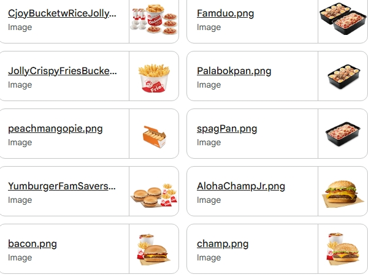
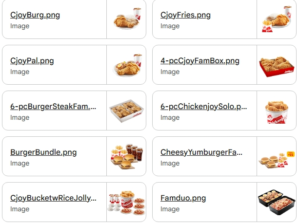
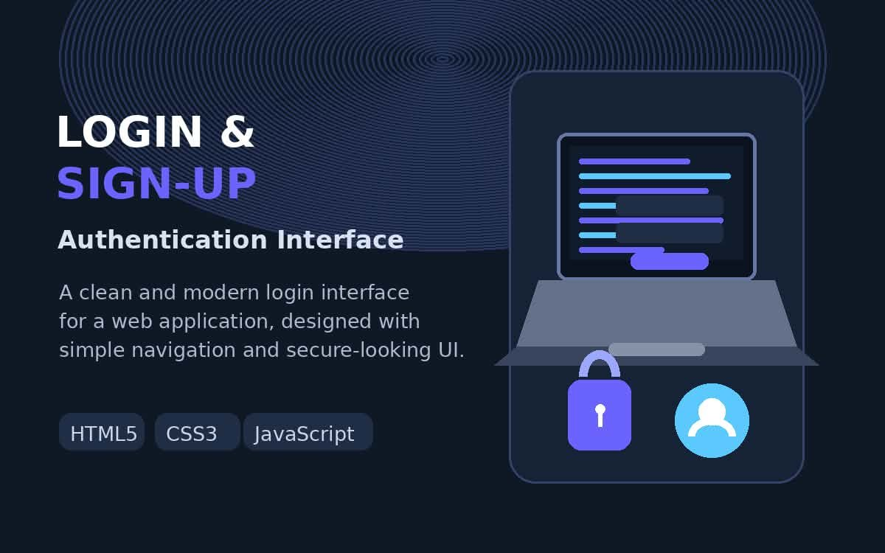
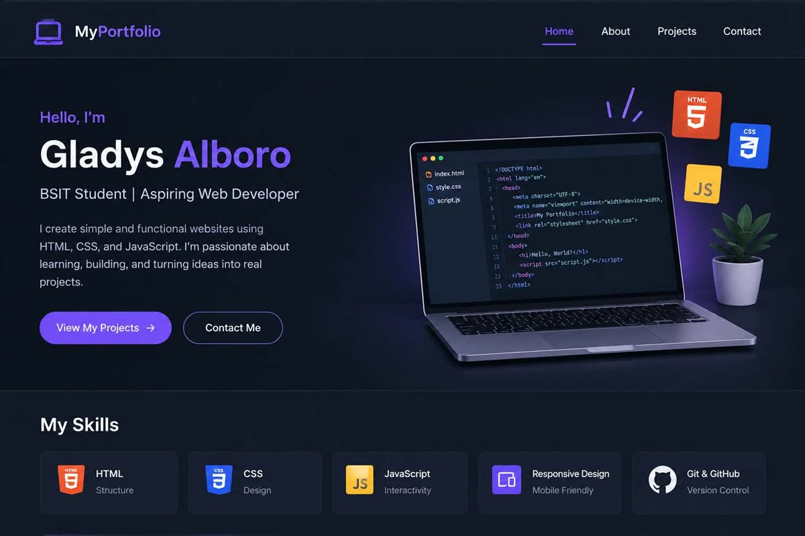

<!--
  PROFILE README — Gladys A. Alboro
  Repo name MUST be exactly: gladysalboro-svg   (GitHub shows a profile README
  only from the repository that matches the username.)

  Maintenance notes:
  - All project descriptions below were written from the actual source code in this workspace.
  - Anything not yet verifiable is marked [NEEDS VERIFICATION] on purpose. Do not delete
    those markers until the real link/screenshot/answer exists.
  - Line to change if "2nd Year" is no longer accurate: search for "2nd Year BSIT".
  - Profile photo beside the name comes from MY PROFILE/19258a5b-....jpg, saved as
    assets/img/profile.jpg (600x600). Replace that one file to change the photo.
  - The hero uses a 2-column HTML table because GitHub Markdown has no CSS: it is the only
    way to place the photo truly beside the name. If you dislike GitHub's table border,
    say so and I will switch it to photo-above-name.
-->

<table>
  <tr>
    <td width="176" valign="middle">
      
    </td>
    <td valign="middle" align="center">
      <h1>Gladys A. Alboro</h1>
      

        
      

    </td>
  </tr>
</table>

 

**Hi, I'm Gladys.** I'm a BSIT student learning to build real software — one project at a time.

I'm currently working through programming fundamentals, object-oriented programming, and web
development. I like taking things apart, rebuilding them, and fixing what breaks along the way.

I may still be early in my journey, but I'm committed to improving step by step — and I'd rather
show you working code than make claims I'm not ready to back up.

 

---

## At a Glance

| | |
|---|---|
| **Who am I?** | 2nd Year BSIT student · Aspiring Software Engineer |
| **What can I build?** | Java Swing desktop apps (OOP) · Login & sign-up interfaces · Beginner web pages |
| **How am I developing?** | Perseverance, continuous learning, and building practical projects |

---

## About Me

I'm a **Bachelor of Science in Information Technology (BSIT)** student learning software
development step by step.

Right now my focus is on the fundamentals — control flow, functions, data structures, and
object-oriented ideas such as encapsulation, inheritance, and working with classes and events.
I like the part where an idea turns into something you can actually click.

I build small projects on purpose: a point-of-sale desktop app, a login and sign-up interface,
and this portfolio. None of them are large, but each one taught me something I couldn't read in a
tutorial — like the fact that a hardcoded file path works on your own machine and nowhere else.

I'm open to feedback, new challenges, and technologies I haven't met yet. If something in my work
is wrong, I'd rather hear it and fix it than defend it.

**Education:** Bachelor of Science in Information Technology (BSIT)
**Location:** Philippines
<!-- [NEEDS VERIFICATION] Confirm school name and full street address before publishing. -->

---

## Technologies I Have Worked With

These are the tools I actually use in my projects. My level in all of them is **beginner /
early-intermediate** — I build with them and I'm still learning them properly.

**Languages**

**Tools & Platforms**

**Also in my workflow:** Microsoft Office · NetBeans IDE (Java/Swing) · Apache Maven · Swing
`JTable` / `JFrame` / `GroupLayout`

> Java is the language I have the most project evidence in. C++ and PHP are listed as technologies
> I am working with — source for them is not in my public repositories yet.
> [NEEDS VERIFICATION] Add the C++ and PHP repositories once they are pushed.

---

## Featured Projects

<table>
  <tr>
    <td width="100%">
      <h3>Simple_POS — Point-of-Sale Desktop Application</h3>
      
<strong>Category:</strong> Object-Oriented Programming Project · Desktop Application 
      <strong>Stack:</strong> <code>Java</code> <code>Swing</code> <code>NetBeans</code> <code>AbsoluteLayout</code>

      
A working desktop cashier application built with Java Swing. Six menu items are displayed
      as image buttons; clicking one increments its quantity and adds it to an order table. The app
      calculates the total automatically, removes items, computes the customer's change, and
      generates a printable receipt.

      
<strong>Key skills demonstrated:</strong> classes and methods · event handling with
      <code>ActionListener</code> · table models and row manipulation · <code>Vector</code> for row
      data · <code>DecimalFormat</code> for money formatting · <code>switch</code> statements ·
      array iteration · <code>try/catch</code> exception handling · GUI layout managers

      

        
        
         Real screenshots from the running application &mdash; click to open full size.
      

      

        
        &nbsp;<em>[ ADD REPOSITORY LINK ]</em> &nbsp;·&nbsp; <em>[ ADD PUBLIC DEMO LINK ]</em>
      

      
The Drive file is shared through Google Classroom, so it asks for a Google sign-in.
      Change its sharing to &ldquo;Anyone with the link&rdquo; before sending this to recruiters.

    </td>
  </tr>
</table>

<table>
  <tr>
    <td width="100%">
      <h3>Login &amp; Sign-Up Interface</h3>
      
<strong>Category:</strong> Programming Project · Authentication UI 
      <strong>Stack:</strong> <code>Java</code> <code>Swing</code> <code>Maven</code>

      
A login and sign-up interface with a split-panel layout, an image panel, and navigation
      between the two screens. Built to understand how a real authentication screen is structured
      before wiring it to a backend.

      
<strong>Key skills demonstrated:</strong> Maven project structure · multiple windows and
      frame navigation · <code>JPasswordField</code> input handling · image resources loaded via the
      classpath · NetBeans Form editor (<code>.form</code> files)

      

        
         Screenshot from the project &mdash; click to open full size.
      

      

        
        &nbsp;
        &nbsp;<em>[ ADD REPOSITORY LINK ]</em>
      

      
The Drive file is shared through Google Classroom, so it asks for a Google sign-in.
      Change its sharing to &ldquo;Anyone with the link&rdquo; before sending this to recruiters.

      
<em>[NEEDS VERIFICATION] The live demo above is hosted under the account
      <code>gladysalboro-lgtm</code>. Confirm whether it is the web version of this Java project
      or a separate web project before describing it as the same thing.</em>

    </td>
  </tr>
</table>

---

## Development Projects

### Programming

- **Login & Sign-Up Interface** (Java) — authentication UI built with Swing and Maven. See Featured Projects.
- **Simple_POS** (Java) — point-of-sale desktop application. See Featured Projects.
- <em>[ ADD C++ PROJECT — no source code found in the workspace yet ]</em>

### Web Development

- **Login page demo** — <a href="https://gladysalboro-lgtm.github.io/sam/main.html">gladysalboro-lgtm.github.io/sam/main.html</a>
  <em>[NEEDS VERIFICATION] confirm which technologies this page actually uses (HTML/CSS, PHP?).</em>
- **Developer Portfolio** — this profile. Hand-written HTML and CSS with a light/dark theme switch.
   
   <em>[ ADD LIVE SITE LINK after GitHub Pages is enabled — expected address:
  <code>gladysalboro-svg.github.io</code> ]</em>

### UI/UX Design

- <em>[ ADD UI/UX PROJECT ]</em> — Canva is part of my workflow. I need the project name and the
  link to document it accurately.

### Documentation & Memories

- **NSTP Memories** — documentation from my National Service Training Program activity.
  Four photos are in this repository under `assets/img/nstp/`.
  <em>[NEEDS VERIFICATION] I need the event name, dates, and what I actually produced or did
  during the program before this is described properly.</em>
- <em>Profile photo</em> — the photo beside my name at the top of this page is my own profile
  picture (`assets/img/profile.jpg`). This resolves the earlier `MY PROFILE` folder, which
  contained only that single image and no source code.</em>

---

## Currently Learning

I'm building my foundation, not rushing ahead of it.

- **Programming fundamentals** — variables, control flow, functions, arrays, and file handling
- **C++** — building small console programs to get comfortable with the language
- **C#** — starting now, to see how the same OOP ideas work in another ecosystem
- **Java** — going deeper past the basics into collections, file I/O, and separating logic from the UI
- **PHP** — connecting forms to a database and handling user input safely
- **Web development** — semantic HTML, modern CSS layout, and responsive design
- **Software engineering concepts** — version control discipline, separating concerns, and writing code someone else can read
- **Git & GitHub workflow** — branches, meaningful commits, issues, and pull requests
- **Practical project building** — finishing, documenting, and deploying something end to end
- **Project documentation** — writing a README that explains what a project does and how to run it
- **Clean, maintainable code** — removing hardcoded values and magic numbers, naming things clearly

I list these as things I'm *working on*, not things I've mastered.

---

## Developer Mindset

I see software development as a loop, not a straight line:

**Learn it → Build it → Break it → Understand why it broke → Fix it → Try again.**

Most of what I know now, I know because something didn't work and I had to find out why. That
process isn't a detour — it *is* the work. Every broken build is a concept becoming clear.

Two things I hold onto:

- **Perseverance** — the first version being wrong is expected. I keep going until it works.
- **Continuous learning** — I don't want to be "done." I want to be getting better.

---

## Contact

**Open to entry-level Software Engineering roles, internships, and junior developer
opportunities — and happy to learn.**

---

**Gladys A. Alboro**
BSIT Student · Aspiring Software Engineer
*"Still learning, still building."*

